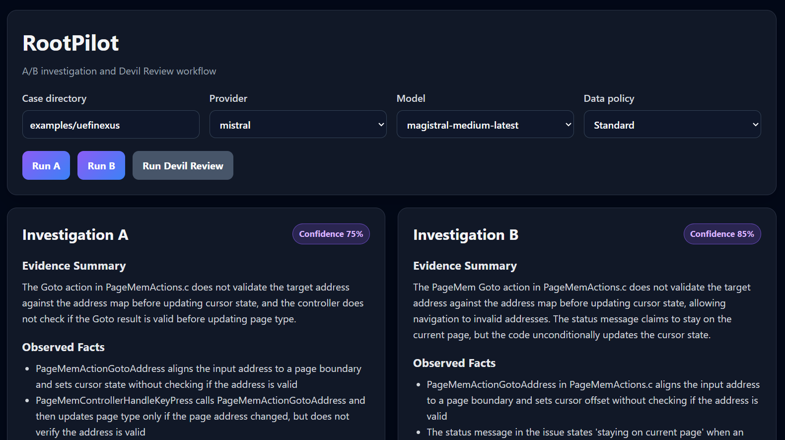
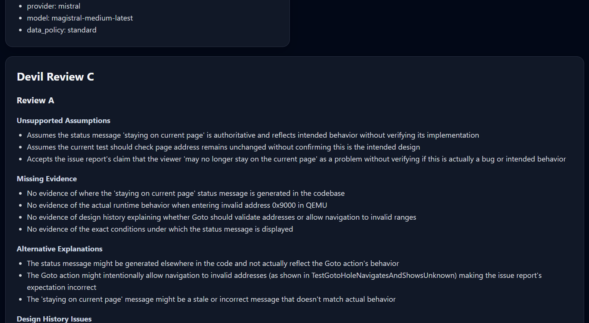

# RootPilot

RootPilot is an evidence-driven AI investigation system designed to improve debugging quality through evidence analysis, hypothesis validation, engineer feedback, and investigation review.

---

# Why RootPilot?

RootPilot started as a tool to automate part of the debugging workflow.

```text
Issue
    ↓
Collect evidence
    ↓
Generate hypotheses
    ↓
Engineer feedback
    ↓
Refine investigation
    ↓
Propose a fix
```

As the project evolved, RootPilot began exploring how to find root causes in large engineering environments.

This led to research areas such as:

- [Routing RAG](https://ziyingchen-dev.github.io/EngineeringWiki/ai/rootpilot/routing-rag/)
- [Multi-Domain Expert Routing](https://ziyingchen-dev.github.io/EngineeringWiki/ai/rootpilot/multi-domain-expert-routing/)
- [Repository RAG](https://ziyingchen-dev.github.io/EngineeringWiki/ai/rootpilot/repository-rag/)

The original assumption was that locating the right repository, module, and source files would be the hardest part of debugging large codebases.

The goal was to narrow the search space before investigation begins.

```text
Issue
    ↓
Routing RAG
    ↓
Repository / Module Selection
    ↓
Repository RAG
    ↓
Investigation
```

However, implementation revealed an unexpected result.

For smaller repositories, modern LLMs can often inspect most or all of the source code directly. Repository discovery is not always the primary bottleneck.

Finding code is not always the hardest problem.

Understanding it correctly is.

As a result, RootPilot's focus has gradually expanded from code discovery to investigation quality.

Today, RootPilot is an evidence-driven AI investigation system designed to improve debugging quality.

---

# Investigation Challenges

The UefiNexus investigation uncovered a different class of problems.

- **Local Trap**: After identifying a suspected issue, the investigation keeps focusing on that area and building evidence around the same assumption.

- **Design History Loss**: A design decision exists, but the reason behind it is no longer visible in the available code, tests, messages, documentation, or investigation context.

- **Context Contamination**: Later investigations or reviews inherit assumptions and conclusions from earlier investigations instead of evaluating the evidence independently.

- **Confidence Inflation**: Confidence increases even though little or no new evidence has been discovered.

An investigation may find the correct repository, the correct file, and even the correct evidence, but still reach the wrong conclusion.

(Reference: [UefiNexus Invalid-Goto Investigation](https://ziyingchen-dev.github.io/EngineeringWiki/ai/rootpilot/uefinexus-invalid-goto-investigation/index.html))

---

# Project Status

RootPilot is still evolving.

Recent investigation experiments uncovered problems that were not part of the original design assumptions. As a result, the future direction of the project is still being explored.

Current implementations, workflows, and research directions should be considered experimental and may change significantly as new investigation challenges are discovered.

The current experimental workflow uses multiple independent investigation sessions:

```text
A: Investigate

B: Investigate

C: Review and challenge A and B
```

The goal is not simply to increase automation, but to improve investigation quality and reduce investigation failures such as local traps, design-history loss, context contamination, and confidence inflation.

## A/B Investigation Experiment

The CLI can save two independent investigation reports and run a Devil's Advocate review over them.

### Cloud Provider: Mistral

Use Mistral only for public or organization-approved non-confidential cases:

```bash
export MISTRAL_API_KEY='your-api-key'

python3 main.py investigate examples/uefinexus \
  --provider mistral \
  --model magistral-medium-latest \
  --data-policy standard \
  --output A.json

python3 main.py investigate examples/uefinexus \
  --provider mistral \
  --model magistral-medium-latest \
  --data-policy standard \
  --output B.json

python3 main.py devil-review examples/uefinexus A.json B.json \
  --provider mistral \
  --model magistral-medium-latest \
  --data-policy standard \
  --output C.json
```

### Local Provider: Ollama

Use local Ollama for NDA-protected or confidential cases.

The default Ollama model is `qwen2.5:1.5b`:

```bash
python3 main.py investigate <case-directory> \
  --provider ollama \
  --data-policy confidential \
  --output A.json

python3 main.py investigate <case-directory> \
  --provider ollama \
  --data-policy confidential \
  --output B.json

python3 main.py devil-review <case-directory> A.json B.json \
  --provider ollama \
  --data-policy confidential \
  --output C.json
```

To use the optional coding model, add:

```bash
--model qwen2.5-coder:3b
```

Each `investigate --output` invocation runs an independent instance of the existing single-investigation workflow. The Devil's Advocate review reloads the case evidence and evaluates both reports against it, including shared assumptions, blind spots, design-history risks, and investigation conflicts. It does not generate fixes or attempt to reach consensus.

Both subcommands accept:

- `--provider ollama|mistral`
- `--model <model-name>` to override the provider's default model
- `--data-policy standard|confidential` (default: `standard`)

If `--model` is omitted, RootPilot uses:

- Mistral: `magistral-medium-latest`, or the value of `MISTRAL_MODEL`
- Ollama: `qwen2.5:1.5b`, or the value of `ROOTPILOT_MODEL`

Confidential mode rejects Mistral and permits Ollama only when `OLLAMA_HOST` is unset or points to `localhost`, `127.0.0.1`, or `::1`.

Saved A, B, and C reports include application-generated provider, model, and data-policy metadata. API keys are never stored in report metadata.

## Web UI

RootPilot also provides a local Vue dashboard backed by FastAPI.

The dashboard supports the same A/B/C investigation workflow:

```text
A: Independent Investigation
B: Independent Investigation
C: Devil's Advocate Review
```

A and B investigate the same case independently. C becomes available after both investigations complete with the same case, provider, model, and data policy.

### Independent Investigations



### Devil's Advocate Review



### Run Locally

Start the FastAPI backend:

```bash
python3 -m uvicorn api_server:app \
  --host 0.0.0.0 \
  --port 8000
```

Start the Vue frontend in another terminal:

```bash
npm run dev --prefix ui -- --host 0.0.0.0
```

Open:

```text
http://localhost:5173
```

When using Mistral, set `MISTRAL_API_KEY` in the same terminal that starts FastAPI:

```bash
export MISTRAL_API_KEY='your-api-key'
```

Patches are applied only after explicit user approval. Blocked or non-actionable investigations do not display an **Accept** button.

Running A or B again clears the previous Devil Review so that C always reviews the latest investigation pair.

---

# License

MIT. See [LICENSE](LICENSE).